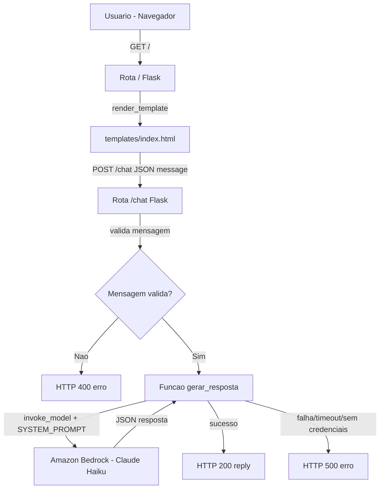
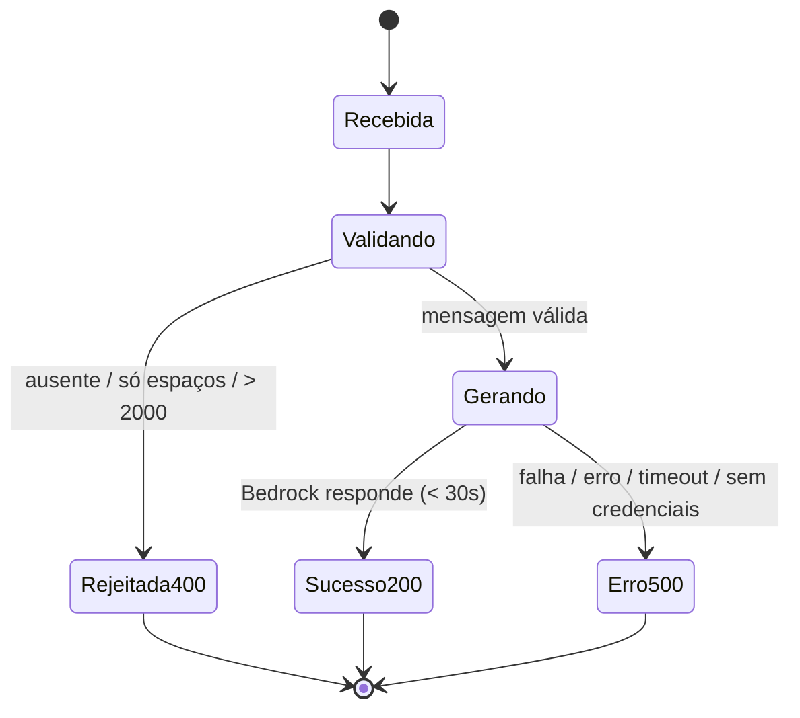

# Documento de Design

## Visão Geral

O KVN é um chatbot educacional de IA construído como uma aplicação Flask mínima e didática. A aplicação serve uma página de chat única (`templates/index.html`) e expõe um endpoint HTTP que recebe mensagens do usuário e devolve respostas geradas pelo Amazon Bedrock (modelo Claude Haiku) por meio da biblioteca `boto3`.

O design prioriza simplicidade: um único arquivo de aplicação (`app.py`) concentra as rotas, a configuração do cliente Bedrock, a constante `SYSTEM_PROMPT` que define a persona do KVN e o tratamento de erros. Não há banco de dados, autenticação, frameworks adicionais nem camadas de abstração. Todo o código é comentado em português.

Este documento atende a todos os 7 requisitos do documento de requisitos e segue estritamente a stack obrigatória definida no steering do projeto (`.kiro/steering/chatbot.md`).

### Decisões de design e justificativas

| Decisão | Justificativa |
| --- | --- |
| Único `app.py` na raiz | Projeto didático, poucos arquivos (Req. 7.2 e estilo do steering). |
| Flask puro, sem extensões | Steering proíbe FastAPI/Django e pede projeto mínimo. |
| `boto3` com `bedrock-runtime` + `invoke_model` | Exigência direta do steering e do Req. 5.1. |
| Credenciais só via variáveis de ambiente | Steering e Req. 5.3/5.4; nunca escrever chaves no código. |
| `SYSTEM_PROMPT` como constante em `app.py` | Req. 4 e steering: persona centralizada e versionável. |
| `app.json.ensure_ascii = False` | Req. 2.2: preservar acentos legíveis no JSON. |
| Sem testes automatizados | Steering proíbe explicitamente testes automatizados. |

## Arquitetura

A aplicação segue uma arquitetura de três camadas lógicas dentro de um único processo Flask:

1. **Camada de apresentação** — `templates/index.html`: interface de chat (campo de texto + botão de envio) que consome o endpoint via `fetch`.
2. **Camada de aplicação/rotas** — `app.py`: rotas `/` e `/chat`, validação de entrada e orquestração.
3. **Camada de integração de IA** — função auxiliar em `app.py` que monta a requisição para o Bedrock e extrai o texto da resposta.



### Fluxo de requisição principal

1. O Usuario abre `http://localhost:5000/` (GET `/`). O Flask renderiza `index.html`.
2. O Usuario digita uma Mensagem e aciona o envio. O front-end envia POST `/chat` com corpo JSON `{"message": "..."}`.
3. O `app.py` valida a Mensagem (presença, não ser só espaços, 1–2000 caracteres).
4. Se válida, a Mensagem é enviada ao Bedrock junto com a `SYSTEM_PROMPT`.
5. O texto da Resposta é extraído e devolvido como `{"reply": "..."}` com status 200.
6. Em qualquer falha (credenciais ausentes, erro do Bedrock, timeout), é retornado erro 500 sem o campo `reply`.

### Inicialização

- `python app.py` inicia o servidor em `localhost:5000` (Req. 1.5, 7.3).
- Se as dependências `flask`/`boto3` estiverem ausentes, o `import` falha e o processo encerra com mensagem indicando a dependência faltante (Req. 7.4) — comportamento padrão do interpretador Python no `ImportError`.
- Se a porta 5000 já estiver em uso, o Flask encerra a inicialização com erro de porta indisponível (Req. 1.6) — comportamento padrão do servidor ao não conseguir fazer bind.

## Componentes e Interfaces

### Componente 1: `app.py` (módulo principal)

Responsabilidades:
- Criar a instância Flask e configurar `app.json.ensure_ascii = False`.
- Definir a constante `SYSTEM_PROMPT`.
- Criar o cliente `bedrock-runtime` do `boto3` na região `us-east-1`.
- Definir as rotas `/` e `/chat`.
- Definir a função auxiliar de geração de resposta.
- Executar o servidor em `localhost:5000` quando chamado diretamente.

Constantes e configurações:

| Nome | Valor | Requisito |
| --- | --- | --- |
| `REGION` | `"us-east-1"` | 5.1 |
| `MODEL_ID` | `"us.anthropic.claude-haiku-4-5-20251001-v1:0"` | 5.2 |
| `MAX_CHARS` | `2000` | 1.3, 3.1 |
| `TIMEOUT_SEGUNDOS` | `30` | 6.1 |
| `SYSTEM_PROMPT` | texto da persona do KVN | 4.1–4.5 |
| `app.json.ensure_ascii` | `False` | 2.2 |

### Componente 2: Rota `GET /`

- **Entrada**: requisição HTTP GET sem corpo.
- **Saída**: HTML renderizado de `templates/index.html`, status 200 (Req. 1.1).
- **Erro**: se o template não puder ser renderizado/encontrado, o Flask levanta exceção e retorna 500 (Req. 1.2).

### Componente 3: Rota `POST /chat`

- **Entrada**: corpo JSON `{"message": "<texto>"}`.
- **Validação** (Req. 3.1): rejeita quando `message` está ausente, é apenas espaços em branco, ou excede 2000 caracteres. Nesse caso retorna 400 **sem** invocar o Bedrock.
- **Saída de sucesso**: `{"reply": "<texto gerado>"}`, status 200 (Req. 2.1, 2.3).
- **Saída de erro de validação**: `{"error": "<descrição>"}`, status 400 (Req. 3.2).
- **Saída de erro de serviço**: `{"error": "<descrição>"}`, status 500, **sem** o campo `reply` (Req. 6.1–6.3).

Contrato HTTP resumido:

| Situação | Status | Corpo JSON |
| --- | --- | --- |
| Mensagem válida, IA responde | 200 | `{"reply": "..."}` |
| Mensagem ausente/vazia/>2000 | 400 | `{"error": "É obrigatório enviar uma mensagem não vazia (1 a 2000 caracteres)."}` |
| Credenciais AWS ausentes | 500 | `{"error": "Serviço de IA indisponível no momento. Tente novamente."}` |
| Falha/erro/timeout do Bedrock | 500 | `{"error": "Não foi possível gerar a resposta agora. Tente novamente."}` |

### Componente 4: Função auxiliar `gerar_resposta(mensagem)`

Responsável por isolar a integração com o Bedrock.
- Monta o corpo da requisição no formato da Messages API da Anthropic.
- Chama `client.invoke_model(...)` com o `MODEL_ID`.
- Faz o parsing da resposta e extrai o texto.
- Propaga/encapsula falhas para que a rota `/chat` possa responder 500.

### Interface de integração com o Amazon Bedrock

**Criação do cliente** (`boto3`): cliente `bedrock-runtime` na região `us-east-1`, com `botocore.config.Config(read_timeout=30, connect_timeout=30, retries={"max_attempts": 0})` para garantir o limite de 30 segundos do Req. 6.1. As credenciais são resolvidas automaticamente pelo `boto3` a partir das variáveis de ambiente (`AWS_ACCESS_KEY_ID`, `AWS_SECRET_ACCESS_KEY` e, quando aplicável, `AWS_SESSION_TOKEN`) — nenhuma chave é escrita no código (Req. 5.3).

**Forma do corpo da requisição** (`invoke_model` → parâmetro `body`, JSON serializado):

```json
{
  "anthropic_version": "bedrock-2023-05-31",
  "max_tokens": 1024,
  "system": "<conteúdo da SYSTEM_PROMPT>",
  "messages": [
    { "role": "user", "content": [ { "type": "text", "text": "<mensagem do usuário>" } ] }
  ]
}
```

Observações:
- A `SYSTEM_PROMPT` vai no campo de topo `system` (instrução de sistema), conforme Req. 4.2 — e **não** dentro de `messages`.
- `anthropic_version` é fixo em `"bedrock-2023-05-31"` (versão da API de mensagens da Anthropic no Bedrock).
- `invoke_model` é chamado com `modelId=MODEL_ID`, `contentType="application/json"`, `accept="application/json"` e `body=json.dumps(corpo)`.

**Forma da resposta e extração do texto:**

A resposta de `invoke_model` traz um objeto cujo campo `body` é um stream. Lê-se o stream, faz-se `json.loads`, obtendo uma estrutura como:

```json
{
  "id": "msg_...",
  "type": "message",
  "role": "assistant",
  "content": [ { "type": "text", "text": "<resposta do KVN>" } ],
  "stop_reason": "end_turn",
  "usage": { "input_tokens": 0, "output_tokens": 0 }
}
```

O texto da Resposta é extraído concatenando os itens de `content` cujo `type` é `"text"` (na prática, `resposta["content"][0]["text"]`). Esse texto é o valor devolvido no campo `reply` (Req. 2.3, 5.1).

Pseudocódigo da integração (comentado em português no código final):

```python
def gerar_resposta(mensagem):
    # Monta o corpo no formato da Messages API da Anthropic
    corpo = {
        "anthropic_version": "bedrock-2023-05-31",
        "max_tokens": 1024,
        "system": SYSTEM_PROMPT,
        "messages": [
            {"role": "user", "content": [{"type": "text", "text": mensagem}]}
        ],
    }
    # Chama o modelo no Bedrock
    resposta = client.invoke_model(
        modelId=MODEL_ID,
        contentType="application/json",
        accept="application/json",
        body=json.dumps(corpo),
    )
    # Lê e interpreta o corpo da resposta
    dados = json.loads(resposta["body"].read())
    # Extrai o texto gerado
    return dados["content"][0]["text"]
```

## Modelos de Dados

O projeto não utiliza banco de dados nem persistência. Os "modelos" são apenas os formatos de troca de dados (em memória / JSON) entre o navegador, o Flask e o Bedrock.

### Entrada do Endpoint_Chat (navegador → Flask)

```json
{ "message": "string, 1 a 2000 caracteres, não apenas espaços" }
```

### Saída de sucesso (Flask → navegador)

```json
{ "reply": "string com o texto gerado pelo KVN" }
```

### Saída de erro (Flask → navegador)

```json
{ "error": "string legível descrevendo o problema" }
```

Regra de distinção (Req. 6.3): respostas de sucesso contêm `reply` e nunca `error`; respostas de erro contêm `error` e nunca `reply`.

### Corpo da requisição ao Bedrock (Flask → Bedrock)

Formato da Messages API da Anthropic descrito na seção de integração (`anthropic_version`, `max_tokens`, `system`, `messages`).

### Corpo da resposta do Bedrock (Bedrock → Flask)

Objeto com `content` (lista de blocos de texto), do qual se extrai `content[0].text`.

### Estados de uma requisição de chat



## A Persona do KVN e o papel da SYSTEM_PROMPT

A `SYSTEM_PROMPT` é o mecanismo central que garante o comportamento exigido no Requisito 4. Ela é enviada no campo `system` de cada chamada ao Bedrock (Req. 4.2), de forma que todas as respostas sejam condicionadas pela mesma instrução, sem depender do histórico (o projeto é sem estado/sem memória de conversa).

A `SYSTEM_PROMPT` deve conter, de forma explícita, as seguintes instruções:

1. **Postura de professor / didática** (Req. 4.1a, 4.3): responder como um professor, explicando o conceito solicitado com linguagem acessível a estudantes iniciantes em IA e, quando aplicável, apresentando ao menos um exemplo.
2. **Humor leve** (Req. 4.1b, 4.4): incluir um comentário de humor leve ao responder a temas de IA, sem comprometer a clareza.
3. **Escopo restrito a estudo de IA** (Req. 4.1c): tratar apenas de temas de estudo de Inteligência Artificial.
4. **Recusa fora de escopo** (Req. 4.5): quando a Mensagem pedir conteúdo não relacionado a estudo de IA, recusar educadamente, não fornecer o conteúdo fora de escopo e redirecionar o Usuario para temas de IA.

Exemplo de esqueleto da constante (texto final em português, comentado):

```python
SYSTEM_PROMPT = """
Você é o KVN, um professor de Inteligência Artificial com didática clara e humor leve.
- Explique os conceitos de forma simples, para iniciantes, e dê ao menos um exemplo quando fizer sentido.
- Inclua um toque de humor leve, sem atrapalhar a clareza.
- Fale somente sobre estudo de Inteligência Artificial.
- Se pedirem algo fora desse tema, recuse com gentileza, não responda ao pedido fora de escopo e convide a pessoa a voltar para assuntos de IA.
"""
```

## Tratamento de Erros

O tratamento de erros cobre os requisitos 1.2, 1.6, 3.1–3.2, 5.4, 6.1–6.4 e 7.4.

### Erros na página (rota `/`)

- **Template ausente/irrenderizável** (Req. 1.2): a exceção de renderização resulta em resposta HTTP 500 indicando falha ao carregar a página. Pode ser o tratamento padrão do Flask ou um handler explícito.

### Erros de validação (rota `/chat`) → HTTP 400

- Gatilhos (Req. 3.1): corpo sem `message`; `message` composta apenas por espaços em branco (`strip()` vazio); `message` com mais de 2000 caracteres; corpo não-JSON/inválido.
- Resposta (Req. 3.2): status 400 com `{"error": "..."}` indicando que uma mensagem não vazia (1–2000 caracteres) é obrigatória.
- Garantia: nesses casos o Bedrock **não** é invocado.

### Erros de serviço de IA (rota `/chat`) → HTTP 500

- **Credenciais ausentes** (Req. 5.4): se o `boto3` não encontrar credenciais nas variáveis de ambiente, a chamada falha; o Flask responde 500 com mensagem de indisponibilidade do serviço de IA, **sem expor** qualquer detalhe de credencial.
- **Falha, erro ou timeout do Bedrock** (Req. 6.1): qualquer exceção do cliente (`ClientError`, `BotoCoreError`, `ReadTimeoutError`) ou estouro do timeout de 30 s resulta em 500.
- **Mensagem de erro** (Req. 6.2): corpo `{"error": "..."}` legível indicando que a geração falhou e que o Usuario pode tentar novamente.
- **Distinção de sucesso** (Req. 6.3): a resposta de erro **omite** o campo `reply`.
- **Resiliência do processo** (Req. 6.4): as exceções são capturadas na rota; o servidor Flask permanece em execução e apto a atender novas requisições.

### Erros de inicialização

- **Dependência ausente** (Req. 7.4): `ImportError` ao importar `flask`/`boto3` encerra o processo exibindo qual módulo está ausente (comportamento padrão do Python, que já nomeia o módulo).
- **Porta em uso** (Req. 1.6): o bind em 5000 falha e a inicialização é encerrada com indicação de porta indisponível.

### Mapa de erros

| Código | Causa | Requisito | Corpo |
| --- | --- | --- | --- |
| 500 (página) | Template não renderizável | 1.2 | indicação de falha ao carregar a página |
| 400 | Mensagem ausente/só espaços/>2000 | 3.1, 3.2 | `{"error": "..."}` |
| 500 | Credenciais AWS ausentes | 5.4 | `{"error": "serviço de IA indisponível"}` |
| 500 | Falha/erro/timeout do Bedrock | 6.1–6.3 | `{"error": "falha ao gerar, tente novamente"}` (sem `reply`) |
| encerra processo | Dependência ausente | 7.4 | mensagem no console com o módulo faltante |
| encerra init | Porta 5000 ocupada | 1.6 | mensagem de porta indisponível |

## Estratégia de Testes

> **Nota sobre testes automatizados:** o steering do projeto (`.kiro/steering/chatbot.md`) **proíbe explicitamente a criação de testes automatizados**. Portanto, este design **não** especifica suíte de testes automatizados nem testes baseados em propriedades (property-based testing). O property-based testing também não seria o instrumento adequado aqui: o núcleo da aplicação é uma integração de I/O com um serviço externo não determinístico (o Amazon Bedrock) e um wrapper HTTP fino, sem funções puras com propriedades universais verificáveis de forma econômica. A verificação é feita manualmente, conforme os roteiros abaixo.

### Invariantes de design (verificação manual)

Mesmo sem testes automatizados, as seguintes invariantes devem ser observadas manualmente para confirmar a corretude:

1. **Exclusão mútua de campos** (Req. 6.3): toda resposta do `/chat` contém `reply` **ou** `error`, nunca ambos. Uma resposta 200 sempre tem `reply`; uma resposta de erro (400/500) nunca tem `reply`.
2. **Validação antes da invocação** (Req. 3.1): para qualquer mensagem inválida (ausente, só espaços, >2000), o Bedrock não é chamado e o retorno é 400.
3. **Preservação de acentos** (Req. 2.2): respostas com caracteres acentuados aparecem legíveis no JSON (sem escapes `\uXXXX`), graças a `ensure_ascii = False`.
4. **Confidencialidade de credenciais** (Req. 5.3, 5.4): nenhuma resposta de erro expõe chaves ou segredos; nenhuma credencial aparece no código-fonte.
5. **Resiliência** (Req. 6.4): após uma falha do Bedrock, uma nova requisição válida ainda pode ser atendida.
6. **Uso exclusivo do modelo e serviço aprovados** (Req. 5.1, 5.2): toda geração usa `invoke_model` do `bedrock-runtime` em `us-east-1` com o `MODEL_ID` exato.

### Roteiro de verificação manual

Com o servidor rodando via `python app.py` (e credenciais AWS configuradas em variáveis de ambiente):

| # | Ação | Resultado esperado | Requisitos |
| --- | --- | --- | --- |
| 1 | Abrir `http://localhost:5000/` no navegador | Página de chat carrega (200), com campo de texto e botão | 1.1, 1.3, 1.4 |
| 2 | Enviar mensagem válida sobre IA (ex.: "o que é overfitting?") | Resposta didática, com humor leve e exemplo, no campo `reply` (200) | 2.1, 2.3, 4.1, 4.3, 4.4 |
| 3 | Conferir acentuação na resposta | Acentos legíveis, sem `\uXXXX` | 2.2 |
| 4 | Enviar POST `/chat` com `message` vazia ou só espaços | Status 400, corpo com `error`, Bedrock não chamado | 3.1, 3.2 |
| 5 | Enviar `message` com mais de 2000 caracteres | Status 400 com `error` | 3.1 |
| 6 | Enviar pergunta fora de escopo (ex.: receita de bolo) | KVN recusa educadamente e redireciona para IA | 4.5 |
| 7 | Rodar sem variáveis de credencial AWS e enviar mensagem válida | Status 500 com `error` de indisponibilidade, sem expor credenciais, sem `reply` | 5.4, 6.3 |
| 8 | Forçar falha/timeout do Bedrock e enviar mensagem válida | Status 500 com `error` legível, sem `reply`; servidor continua ativo na próxima requisição | 6.1–6.4 |
| 9 | Executar `python app.py` sem `flask`/`boto3` instalados | Processo encerra indicando a dependência ausente | 7.4 |
| 10 | Iniciar com a porta 5000 já ocupada | Inicialização encerra com indicação de porta indisponível | 1.6 |
| 11 | Iniciar com dependências instaladas | Servidor sobe em `localhost:5000` em poucos segundos | 1.5, 7.3 |

### Ferramentas sugeridas para verificação manual

- Navegador para a interface (`/`).
- `curl` ou a aba de rede do navegador para testar o `/chat` com corpos específicos (válidos, vazios, muito longos, fora de escopo).

## Rastreabilidade de Requisitos

| Requisito | Onde é atendido no design |
| --- | --- |
| 1.1–1.6 | Rota `GET /`, inicialização em `localhost:5000`, tratamento de template/porta |
| 2.1–2.3 | Rota `POST /chat`, integração Bedrock, `ensure_ascii = False`, campo `reply` |
| 3.1–3.2 | Validação de entrada na rota `/chat` (400 sem invocar Bedrock) |
| 4.1–4.5 | `SYSTEM_PROMPT` enviada no campo `system` da requisição |
| 5.1–5.4 | Cliente `bedrock-runtime` + `invoke_model`, `MODEL_ID`, credenciais via env, erro 500 |
| 6.1–6.4 | Timeout de 30 s, captura de exceções, 500 sem `reply`, processo resiliente |
| 7.1–7.4 | `requirements.txt` (flask, boto3), estrutura `app.py`/`templates/index.html`, execução |
